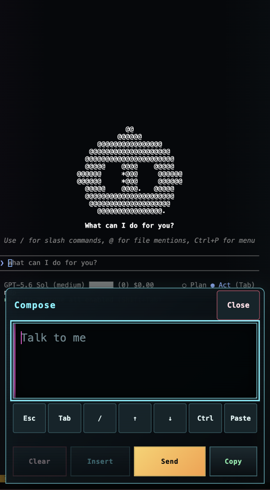

<p align="center">
  
</p>

<h1 align="center">driftty</h1>

<p align="center">
  A mobile-first web terminal for local shells, remote hosts, and persistent tmux sessions.
</p>

<p align="center">
  
  
  
</p>

driftty packages a touch-friendly terminal client with `ttyd`, authentication,
reconnection, and tmux/SSH routing. Start with a standalone binary or one of the
Docker and hosted options below.

## Standalone binary (Linux)

One terminal, one executable, no Docker or gateway needed. Releases include
statically linked **x86_64** and **aarch64** binaries with the mobile UI embedded.

```sh
curl -fsSL https://github.com/mdp/driftty/releases/latest/download/install.sh | sh
driftty-terminal bash -l
```

Open <http://127.0.0.1:7681>. Startup prints username **`driftty`** and a fresh,
cryptographically random **30-character lowercase base36 password** for the
browser's Basic Auth prompt. The listener defaults to **127.0.0.1:7681**, terminal
input is enabled, and cross-origin WebSocket connections are rejected. Nothing
is installed as a service or started automatically by the installer.

The installer verifies SHA-256 checksums and installs to `~/.local/bin` without
sudo. If that directory is not on your PATH, follow the printed PATH hint.
To select a release or installation directory:

```sh
curl -fsSL https://github.com/mdp/driftty/releases/latest/download/install.sh |
  sh -s -- --version vX.Y.Z --bin-dir "$HOME/.local/bin"
```

Replace `vX.Y.Z` with a published release that includes the native binaries.
To choose persistent credentials or change the port:

```sh
driftty-terminal -p 8080 -c 'driftty:your-password' bash -l
```

**Basic Auth does not encrypt HTTP.** For a remote box, leave the default
loopback bind in place and forward the port from your laptop:

```sh
ssh -N -L 7681:127.0.0.1:7681 user@remote-box
```

Then open <http://127.0.0.1:7681> locally. Use `-i <private-IP>` to bind on a
trusted VPN instead, or configure ttyd's TLS options for HTTPS. Do not expose
plain HTTP on the public internet. Generated credentials rotate on restart and
are printed in startup output; protect those logs. Explicit `-c` credentials
can appear in process listings and shell history.

Replace `bash -l` with any installed TUI command. Commands start when a browser
connects; use `tmux attach-session` for persistence across reconnects. Build and
release details: [`scripts/native/README.md`](scripts/native/README.md).

## 1. Try it with Docker

With Docker running, start a disposable shell:

```bash
docker run --rm --pull always -p 127.0.0.1:7681:7681 \
  ghcr.io/mdp/driftty:edge sh
```

Open <http://localhost:7681> and start typing. No checkout, keys, account, or
configuration is needed. Ctrl+C stops the container. Use `latest` for the last
versioned release.

More Docker images and command examples are in
[`examples/docker-images`](./examples/docker-images/README.md).

## 2. Put a demo on InstaCloud

Copy this into Claude Code, Codex, Cursor, OpenCode, or another coding agent:

```text
Set up the driftty multi-agent demo on InstaCloud.

Install the insta CLI and agent skill with `npx -y insta@latest setup agent`.
Check `insta status`, sign in with `insta login` if needed, then use the
canonical setup in `examples/insta/prompt.md` (or fetch it from
https://raw.githubusercontent.com/mdp/driftty/main/examples/insta/prompt.md).
Run the setup yourself, stop only for sign-in or approval gates, and report the
public HTTPS URL and how to sign in. Never print secret values.
```

The complete prompt and runnable setup are in
[`examples/insta`](./examples/insta/README.md). It deploys the published demo
image, creates a password-protected HTTPS URL, and starts a tmux session with
the included coding-agent tabs.

## 3. Run the gateway as a Docker service

Use the gateway when the browser should reach tmux on another host. Compose
runs the gateway and (optionally) a tunnel or reverse proxy; the gateway reads
SSH profiles and keys from mounted files, connects to each configured host, and
attaches the browser to remote tmux sessions:

```text
browser -> HTTPS/tunnel -> gateway:7681 -> SSH -> host tmux -> shell
```

Each target needs an SSH server, a key installed for the configured user, and
tmux when using persistent sessions. The gateway password protects the picker;
keep the public endpoint behind HTTPS and use a strong password.

For a copyable no-host-port deployment using Cloudflare Tunnel, see
[`examples/cloudflare-ssh`](./examples/cloudflare-ssh/README.md). It includes
Compose, the environment schema, profiles, key generation, and the Varlock
wrapper. The short local-development version is
[`examples/docker-development`](./examples/docker-development/README.md).

## Choose an example

| Need | Example |
| --- | --- |
| Disposable shell or standalone `ttyd` command | [`docker-images`](./examples/docker-images/README.md) |
| Hosted coding-agent demo | [`insta`](./examples/insta/README.md) |
| SSH gateway behind Cloudflare Tunnel | [`cloudflare-ssh`](./examples/cloudflare-ssh/README.md) |
| Gateway against a local tmux socket | [`local-tmux`](./examples/local-tmux/README.md) |
| Local SSH/tmux integration environment | [`docker-development`](./examples/docker-development/README.md) |
| Release bundle or detailed profile reference | [`gateway-reference`](./examples/gateway-reference/README.md) |

## Gateway configuration and direct execution

From the checkout:

```sh
npm ci
npm run env:check
npm run compose -- config --quiet
npm run compose -- up -d --wait
```

The root schema requires the Cloudflare token. Its gateway password is optional,
matching the generated-password behavior. Both deployment examples require a
password; the development schema also validates ports and user/group IDs.
Use the example's own environment files with:

```sh
npm run compose:cloudflare -- up -d --wait
npm run compose:development -- run --build --rm keygen development
npm run compose:development -- up --build -d --wait
```

For a copied example or release bundle, install the standalone Varlock CLI or
use the pinned npm command from that deployment directory:

```sh
npx --yes varlock@1.18.0 load --agent
npx --yes varlock@1.18.0 run --inject vars -- docker compose up -d --wait
```

`load --agent` gives redacted diagnostics. Raw JSON, env/shell exports, and
`printenv` can reveal secrets. Wrapping Compose validates and injects settings;
it does not encrypt `.env` files, hide the container environment from Docker
administrators, or protect output from later unwrapped commands. SSH private
keys remain files in `keys/`. The one-command terminal trial needs no Varlock.

## Security and connection behavior

The gateway password protects the picker and every terminal HTTP, asset,
token, and WebSocket route. Only `/login`, `/logout`, and `/_health` are
public. Login creates a signed, HTTP-only session for 30 days. Cookies are
marked secure when HTTPS reaches the gateway directly or is reported through
`X-Forwarded-Proto`.

The signing key derives from `DRIFTTY_PASSWORD`. Keeping the password preserves
browser sessions across restarts; changing it invalidates them. An automatic
password is deliberately process-local and rotates on restart.

For trusted-network development only, pass `--no-auth` to the gateway (for
example, `command: ["--no-auth"]` in Compose). It overrides
`DRIFTTY_PASSWORD`, prints a warning, and removes login controls. Never use it
on an untrusted network.

SSH uses keys only, learns previously unseen host keys, and rejects changed
ones. Each browser terminal gets its own SSH process; tmux preserves the remote
shell behind it. Local mode instead runs a containerized tmux client against
the mounted host socket. The TypeScript gateway handles authenticated HTTP and
WebSocket routing in-process and can run on Bun or Node.js.

Run the gateway and optional workspace daemon from a checkout:

```bash
npm run driftty -- serve
# Bun alternative:
npm run driftty:bun -- serve
```

`serve` uses the packaged Driftty terminal client (building it only when the
client is missing), then runs the public gateway and, when
`DRIFTTY_ENABLE_WORKSPACES=1`, the Vercel workspace API in the same process.
It downloads ttyd **1.7.7** on first use, verifies the official release SHA-256,
and caches the executable under `~/.cache/driftty/ttyd/`; no global ttyd
installation is needed. The managed binary currently supports Linux x64/arm64
and Windows x64. SSH profiles still require the system `ssh` client.
With no profile file, it starts an empty gateway rather than requiring
container-mounted `/config` paths. Put `profiles.yaml` and (for workspace
provisioning) `workspaces.yaml` in `~/.config/driftty/`; state and SSH known
hosts default to `~/.local/state/driftty/`. `XDG_CONFIG_HOME` and
`XDG_STATE_HOME` are honored, and `PROFILES_FILE`, `DRIFTTY_PROJECTS_FILE`,
`DRIFTTY_STATE_FILE`, and `KNOWN_HOSTS_FILE` can override individual paths.

Set `DRIFTTY_PORT` to change the public listener. For SSH profiles, install
`ssh` and configure keys in `profiles.yaml`. To use Vercel workspaces,
enable them and provide the Vercel credentials plus project definitions. A
standalone remote terminal is also available with `--remote-terminal
https://…` and `DRIFTTY_REMOTE_TERMINAL_AUTH`. `driftty workspace ...` remains
the client for managing workspaces through the running server.

To restrict a host run to the Tailscale interface, set `DRIFTTY_HOST` to the
machine's Tailscale IPv4 address (for example, `100.x.y.z`).

When a shell exits normally, driftty shows an **Exited** screen. Unexpected
network interruptions reconnect with backoff.

## Develop the web client

The fast UI loop runs Vite with hot module replacement and proxies `/token`
and `/ws` to a disposable Alpine terminal:

```bash
DRIFTTY_DEV_TOKEN=abc123secret \
  DRIFTTY_DEV_TAILSCALE_IP="$(tailscale ip -4)" \
  DRIFTTY_DEV_HOSTNAME=aachen.weasel-dojo.ts.net \
  docker compose -f compose.dev.yaml up --build -d
```

Open `http://127.0.0.1:7681/abc123secret` once to set the development access
cookie. For the tailnet URL, replace the host with the value supplied in
`DRIFTTY_DEV_HOSTNAME`. Changes under `src/` reload automatically.

If you only need loopback, Compose still requires the Tailscale values because
it declares both port bindings. A local-only invocation can use
`DRIFTTY_DEV_TAILSCALE_IP=127.0.0.2` and
`DRIFTTY_DEV_HOSTNAME=localhost`.

## Security notes

The gateway uses one master password for all configured terminals. It is alpha
software: there is no rate limiting or multi-user authorization. SSH uses keys,
learns new host keys, and rejects changed host keys. Treat the gateway password,
Cloudflare token, profiles, and private keys as one access boundary.

Keep public deployments behind HTTPS. Do not expose a host tmux socket or an
unauthenticated standalone `driftty` container to an untrusted network. For
the complete authentication, connection, and secret-handling details, see
[`examples/gateway-reference/security.md`](./examples/gateway-reference/security.md).

## Develop and test

The UI uses Vite; gateway tests use Bun. Requirements are Node 24+, Bun, and
Docker:

```bash
npm ci
bun install --cwd gateway --frozen-lockfile
npm run test:all
npm run build
```

For the hot-reload UI workflow and the full build/test commands, see
[`examples/gateway-reference/development.md`](./examples/gateway-reference/development.md).

## Images

| Image | Use it for | Persistence |
| --- | --- | --- |
| `ghcr.io/mdp/driftty` | One command or local shell | Lifetime of the command |
| `ghcr.io/mdp/driftty-demo` | Coding-agent demo | Lifetime of the container |
| `ghcr.io/mdp/driftty-gateway` | Local tmux, SSH hosts, and stable shell routes | Host or remote tmux |

## Attribution

driftty is MIT licensed. The client began with the
[ttyd web client](https://github.com/tsl0922/ttyd) by Shuanglei Tao and the
[overlay-key project](https://github.com/ar90n/ttyd-overlay-keys-html) by
Masahiro Wada. Their work and copyright notices are retained with thanks.
